# How Throughline works

This document walks through every feature of Throughline and points at the code
that implements it. Each section starts with what you see, explains the flow
from your action to the change in your pages, and ends with a table of the
pieces and links to their lines.

The whole library is one file, [`Throughline.md`](Throughline.md): a
`space-lua` block for the behaviour and a `space-style` block for the look.
Links to the behaviour point to [`throughline.lua`](throughline.lua), an exact
copy of that block that GitHub shows with syntax highlighting; links to the
look point to the stylesheet in `Throughline.md`. The [README](README.md)
covers installing and using it. Line links are correct for the version this
file was written with; if they drift, search for the function name.

## Contents

- [Task states and their icons](#task-states-and-their-icons)
- [Task pages](#task-pages)
- [Projections](#projections)
- [Making, promoting and deleting task pages](#making-promoting-and-deleting-task-pages)
- [The board](#the-board)
- [Project status, updates and health](#project-status-updates-and-health)
- [Time logging](#time-logging)
- [The projects overview](#the-projects-overview)
- [Project commands](#project-commands)
- [The Focus list](#the-focus-list)
- [Focus filters](#focus-filters)
- [Settings and themes](#settings-and-themes)
- [Shared machinery](#shared-machinery)

## Task states and their icons

Every task has a state, such as `[DOING]` or `[x]`. Each state has a label, a category and, for the default states, an icon. The icon appears in the editor, on the board and Focus widgets, and on links to task pages.

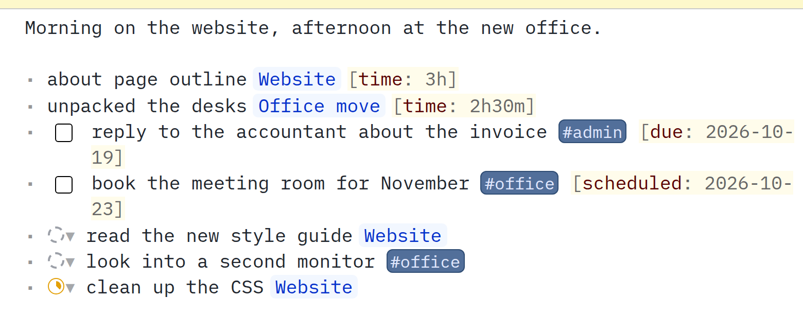

### How it works

The states are a setting, `throughline.states`. Its default holds seven states in board order. `tl.states` reads the setting. The loop after it registers each custom state with SilverBullet's task-state system, so completion and the state picker know the name. The loop skips the `" "` and `"x"` states, which are the standard markdown checkboxes. It marks a state as done when its category is `done` or `cancelled`.

Other code asks `tl.categoryOf` what a state means. `tl.categoryOf` looks the state up with `stateEntry` and returns its `category`. A setting without categories still works. In that case `tl.categoryOf` reads `closed = true` as done, and it takes the category from `defaultCategories` for the default state names. Any other name counts as planned.

Three functions build on the category and the label:

- `tl.isClosedState` is true for the `done` and `cancelled` categories.
- `tl.labelOf` returns the state's `label`, or its name when it has none.
- `tl.columnOf` returns `closed` for a closed state. Otherwise it returns the state's `column`, or its label. The board groups cards by this value.

When a card is dropped into a column, `tl.columnState` picks the state. A closed column gives `x`. Any other column gives the state marked `drop = true`, or else the column's first state.

`shownState` turns a state into the name the stylesheet uses in `data-tl-state` attributes. It maps `" "` to `todo` and `x` or `X` to `done`. The State icons block in the stylesheet draws the icon in three places: SilverBullet's own task marks, the widgets, and projection links. Each default state has its own rule. A custom state has no icon. A projection shows its name as a small label, and a widget shows a plain ring.

| Piece | Code |
| --- | --- |
| The states setting | [`throughline.states`](throughline.lua#L63) |
| Reading the setting | [`tl.states`](throughline.lua#L116) |
| Registering custom states with SilverBullet | [`taskState.define`](throughline.lua#L122) |
| Finding a state entry | [`stateEntry`](throughline.lua#L315) |
| Fallback categories for default names | [`defaultCategories`](throughline.lua#L321) |
| The category of a state | [`tl.categoryOf`](throughline.lua#L338) |
| Closed or not | [`tl.isClosedState`](throughline.lua#L350) |
| The label of a state | [`tl.labelOf`](throughline.lua#L355) |
| The board column of a state | [`tl.columnOf`](throughline.lua#L363) |
| The state a dropped card takes | [`tl.columnState`](throughline.lua#L372) |
| The name used in `data-tl-state` | [`shownState`](throughline.lua#L391) |
| Icons for the states, in the stylesheet | [`State icons`](Throughline.md?plain=1#L2884) |

## Task pages

A task page is a page in the task folder, `Tasks/` by default. Its first top-level task is the task, and the rest of the page is its notes. Every projection of the page shows that task's state. Changing the state from a projection writes to the task page.

### How it works

`tl.sources` walks the task index for top-level tasks on pages in the task folder. It keeps the earliest task on each page, which is the page's source. Given a project name, it keeps only the sources that link to that project. The result has one task per task page.

`tl.setTaskPageState` changes the state of one page. It reads the page with `tl.read` and finds the first task line that starts at the left margin. It replaces the text between the square brackets with the new state, and writes the page with `tl.write`. Then it records the new state with `tl.noteState`, so every icon shows it at once (see Projections). If the page has no task, it shows an error and stops.

[`tl.setTaskAttr`](throughline.lua#L556) sets one attribute, such as `[due: 2026-11-01]`, on the same task line: it replaces the value when the attribute is there, appends it at the end of the line when not, and removes it when the value is empty. [`tl.taskAttrs`](throughline.lua#L527) reads the attributes back from the line. Both find the line with [`taskLineIn`](throughline.lua#L498), which `tl.setTaskPageState` uses too.

`tl.read` and `tl.write` choose the route for a page. For the page open in the editor, they read and set the editor's text. Other pages go through `space.readPage` and `space.writePage`. The code comment says that writing the open page behind the editor leaves a stale buffer, and that a later save writes over the change. For the open page, `tl.write` also skips the write when the text is already the same.

| Piece | Code |
| --- | --- |
| Finding the source task of each task page | [`tl.sources`](throughline.lua#L477) |
| Changing the state of a task page | [`tl.setTaskPageState`](throughline.lua#L540) |
| Finding the task line on a task page | [`taskLineIn`](throughline.lua#L498) |
| Setting or removing one attribute | [`tl.setTaskAttr`](throughline.lua#L556) |
| Reading the attributes | [`tl.taskAttrs`](throughline.lua#L527) |
| Reading a page through the editor when it is open | [`tl.read`](throughline.lua#L412) |
| Writing a page through the editor when it is open | [`tl.write`](throughline.lua#L417) |

## Projections

A projection is a plain link to a task page, such as `- [[Tasks/rerun-load-test|rerun the load test]]`. In the editor, the link shows the task's state icon in front of its text and, when the task has one, its due date after it, red once past. Clicking the text opens the page. Clicking the icon or the date opens a small panel for editing the task in place: its state, its due and scheduled dates, its progress, and Delete task page.

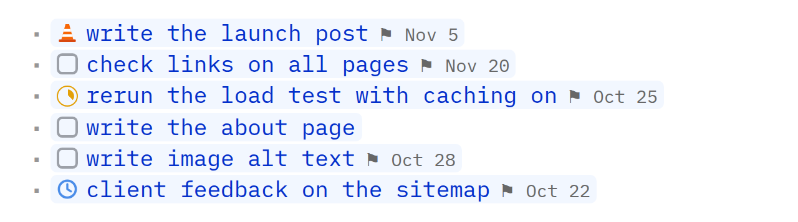

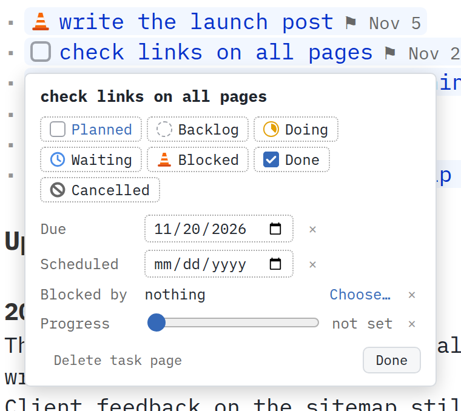

### How it works

Drawing the icons. [`tl.markLinks`](throughline.lua#L2342) finds every wiki link in the editor's main area. For each one it asks [`tl.stateOf`](throughline.lua#L2301) for the state of the linked page, and [`tl.dueOf`](throughline.lua#L2330) for its due date. A task page's link gets `data-tl-state`, with the name from [`shownState`](throughline.lua#L391); the stylesheet draws the icon from that. It also gets `data-tl-due` with the short date, and `data-tl-late` when the date has passed and the task is still open; the stylesheet draws the date after the link. Links to other pages are left alone.

`tl.markLinks` runs whenever the editor adds elements: when a page opens, when lines scroll into view, when a widget draws. A watcher on the editor, [`tl.onEditorChange`](throughline.lua#L2529), queues it for the next animation frame, so icons appear about a tenth of a second after a page opens. The background tick runs it once a second as well.

The state cache. [`tl.stateOf`](throughline.lua#L2301) builds a map from page name to state, and one from page name to due date, from [`tl.sources`](throughline.lua#L477). It keeps them in `tl.stateMap` and `tl.dueMap`. The tick clears the map every third second, so a change made by hand or on another device shows within a few seconds. A change made by Throughline itself shows at once: [`tl.noteState`](throughline.lua#L2336) puts the new state straight into the map, and records it in `tl.pending`. SilverBullet's index takes a moment to see a write, so until it does, `tl.pending` wins over the index (see [`pendingState`](throughline.lua#L463)). Without that, an icon would flip back to the old state for a few seconds after every change. Due dates get the same treatment through `tl.pendingDue`. A brand new task page, which the index does not know yet, is added to the map from `tl.pending` too.

Clicks. Listeners for mouse presses and clicks cover the whole document, in the capture phase, so they run before SilverBullet does. The panel opens on the press, in [`tl.onLinkPress`](throughline.lua#L2483): once the editor has focus, a press on a line moves the cursor there and SilverBullet swaps the link for its raw markdown, so a click handler would miss it. The click that follows is swallowed by [`tl.onLinkClick`](throughline.lua#L2493) so the link does not navigate. A marker attribute on `<html>` stops a second registration, because the file runs again on every configuration reload. A press outside an open panel closes it. On a projection, a press within about one link height of the left edge counts as a press on the icon, and a press on the date at the right end counts too; [`projectionHit`](throughline.lua#L2468) decides. Both open the panel with [`tl.openTaskPopover`](throughline.lua#L2402). Anything else passes through, and the link navigates as usual.

The panel. [`tl.openTaskPopover`](throughline.lua#L2402) builds plain DOM with `dom.*` and appends it to `<body>`, outside the editor, under the link. SilverBullet offers no way to put controls inside the editor, and elements inserted there would be read back as text, so the panel lives outside it. The top row has one button per configured state; a click calls [`tl.setTaskPageState`](throughline.lua#L540) and then [`tl.refreshStates`](throughline.lua#L2386), which redraws the links and calls [`tl.syncWidgets`](throughline.lua#L2369) so a board card on the same page moves at once. Below that is the form from [`attrForm`](throughline.lua#L643), which the board card uses too: Due and Scheduled are `<input type="date">` fields, so the browser's own calendar opens, and Progress is a slider. Each field writes on change through [`tl.setTaskAttr`](throughline.lua#L556). Its values come from [`tl.taskAttrs`](throughline.lua#L527), which reads the task page's text rather than the index, so they are current even right after a change. Escape, Done, scrolling, or a click outside closes the panel through [`tl.closePopover`](throughline.lua#L2395).

Blocked by. The form's Blocked by row shows the blocking task's name. Choose… opens SilverBullet's picker over the open task pages and writes `[blockedBy: [[Tasks/x]]]` through [`tl.setTaskAttr`](throughline.lua#L556); × removes it. While the picker shows, `tl.picking` keeps the panel open. [`linkTarget`](throughline.lua#L513) reads the page name back from the attribute, whether it comes from the page text or the index, and [`blockedChip`](throughline.lua#L626) draws "⛔ blocked by …" on board cards and Focus rows, struck through once the blocker's state is closed. [`tl.titleOf`](throughline.lua#L2324) gives the blocker's task text from the state cache.

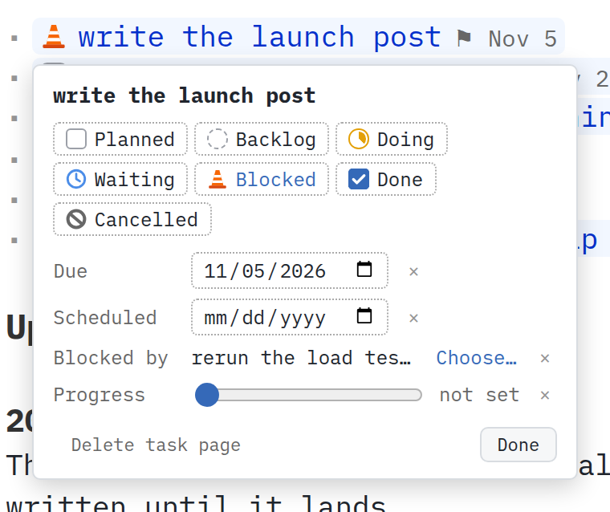

Progress. [`taskProgress`](throughline.lua#L598) gives a task's progress in percent: its `[progress: n]` attribute if it has one, else the share of its subtasks that are done, cancelled ones left out. The slider writes `[progress: n]`; its × removes the attribute, so the task goes back to counting subtasks.

| Piece | Code |
| --- | --- |
| Drawing state and due date on every projection link | [`tl.markLinks`](throughline.lua#L2342) |
| The editor watcher that runs it at once | [`tl.onEditorChange`](throughline.lua#L2529) |
| The state and due-date cache | [`tl.stateOf`](throughline.lua#L2301) |
| A task page's due date | [`tl.dueOf`](throughline.lua#L2330) |
| Recording a state Throughline just wrote | [`tl.noteState`](throughline.lua#L2336) |
| Preferring a just-written state over the index | [`pendingState`](throughline.lua#L463) |
| Click handling for the icon, the date and the text | [`tl.onLinkClick`](throughline.lua#L2493) |
| The editing panel | [`tl.openTaskPopover`](throughline.lua#L2402) |
| Closing it | [`tl.closePopover`](throughline.lua#L2395) |
| Date and progress fields | [`attrForm`](throughline.lua#L643) |
| Reading a link-valued attribute | [`linkTarget`](throughline.lua#L513) |
| The blocked-by chip | [`blockedChip`](throughline.lua#L626) |
| A task page's task text | [`tl.titleOf`](throughline.lua#L2324) |
| Progress of a task | [`taskProgress`](throughline.lua#L598) |
| Redrawing links and widgets after a change | [`tl.refreshStates`](throughline.lua#L2386) |
| Moving board cards and Focus rows to match | [`tl.syncWidgets`](throughline.lua#L2369) |
| The panel's stylesheet | [Task popover block](Throughline.md?plain=1#L3569) |

## Making, promoting and deleting task pages

Put the cursor on a task and run `Throughline: Make task page`, or type `/task`. Throughline suggests a page name from the task text. The task and its subtasks move to a new page in the task folder, and a projection takes their place. Promote subtask does the same for a subtask on a task page, and the new page records its parent. Delete task page removes the page and every projection of it, after it lists where they are.

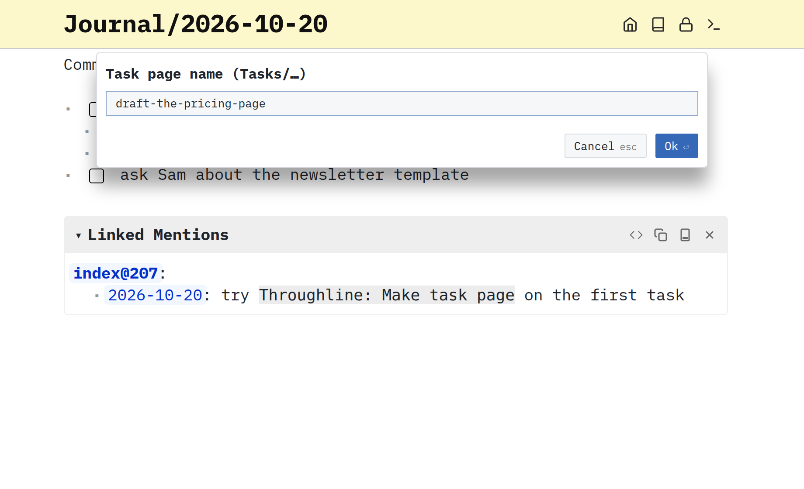

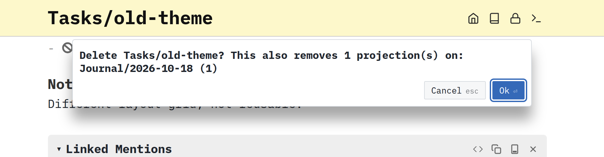

### How it works

`tl.makeTaskPage` starts the flow. It calls `blockAt` with the editor text and the cursor. `blockAt` finds the task line under the cursor and every line below it that is indented further. It returns the block's range and indent, its lines with the indent removed, whether the task is nested, and the project of the nearest less-indented line above that links to a project.

The function asks for a page name with `editor.prompt`. The default comes from `tl.slugFor`. That function takes the task text without links and attributes, lowercases it, and joins words with hyphens. It cuts the name to 40 characters and then adds `-2`, `-3` and so on while a page with that name exists. If the name the user enters already exists, the function shows an error and stops.

Next, `tl.makeTaskPage` finds the project. It checks, in order: a project link on the task's first line, the current page if it is a project page, the project inherited through `blockAt`, and then the project link in the current task page's text. When it finds one, it adds a link to that project on the task's first line.

The new page gets front matter that hides it from the page tree, then the task block. A nested task on a task page also gets a `partOf` line that points to its parent. This is the promotion case. The task in the editor is then replaced by a projection, `- [[Tasks/<name>|<text>]]`. If the project is a different existing page, `appendToList` adds the projection to the project's list. That function places the projection after the last existing projection, or adds a `## Tasks` heading at the end. The project page is read and written with `tl.read` and `tl.write`. Last, the state cache is cleared.

`tl.deleteTaskPage` deletes a page and its projections. Without an argument it uses `taskPageAtCursor`. That function returns the open page if it is a task page, or else the task page linked on the current line. `tl.deleteTaskPage` scans the link index for pages that link to the target. On each of those pages it counts the list items that start with a link to the target. It then asks for confirmation and lists the pages with their counts. After confirmation, it removes those lines from each page. If the target is the open page, it navigates to the index. It deletes the page with `space.deletePage` inside `pcall`. The deletion reaches the server only at the next sync. Other links to the page stay, as links to a missing page.

The commands and the slash command call these functions. Make task page and Promote subtask both call `tl.makeTaskPage`. Delete task page calls `tl.deleteTaskPage` with no argument. For `/task`, if the current line is not a task, the command asks for the task text and inserts `- [ ] <text>` at the cursor. Then it calls `tl.makeTaskPage`.

| Piece | Code |
| --- | --- |
| Making a task page, and promoting a subtask | [`tl.makeTaskPage`](throughline.lua#L2672) |
| Finding the task block under the cursor | [`blockAt`](throughline.lua#L2627) |
| Suggesting a page name from task text | [`tl.slugFor`](throughline.lua#L2608) |
| Adding a projection to a project's list | [`appendToList`](throughline.lua#L975) |
| Choosing the task page for a delete | [`taskPageAtCursor`](throughline.lua#L2719) |
| Deleting a task page and its projections | [`tl.deleteTaskPage`](throughline.lua#L2730) |
| The three commands | [`command.define`](throughline.lua#L2771) |
| The `/task` slash command | [`slashCommand.define`](throughline.lua#L2776) |

## The board

The board is a widget. Put `${throughline.board()}` on a project page and it draws one column per open state. Each card is one of the project's task pages. Expand a card to see its subtasks and notes, and tick subtasks there. Change a card's state by dragging it to another column or to a new place in the same column.

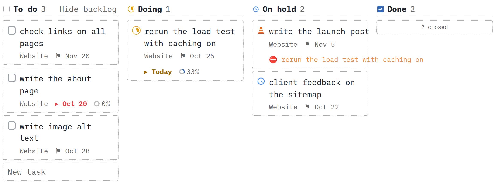

### How it works

[`tl.board`](throughline.lua#L1160) takes the project, which defaults to the page it sits on. It gathers the project's tasks and sorts them. The order follows the project page's own list of task links, read by [`listOrder`](throughline.lua#L961), which keeps the first position of each link. Tasks the list leaves out come after the listed ones, earliest due first.

Next, `tl.board` makes one column for each distinct column key among the open states. A card goes into the column its state maps to through [`tl.columnOf`](throughline.lua#L363). Each column comes from [`column`](throughline.lua#L1110). It has a head with the state icon, a count, and a list of cards. The Done column is different. It holds the closed tasks, and [`column`](throughline.lua#L1110) folds it inside a `details` element that shows "N closed".

Each card comes from [`card`](throughline.lua#L846). The card is a `details` element. Its summary holds the state icon, the title and the chips, from [`cardChips`](throughline.lua#L829). The project name is the first chip. The due and scheduled dates follow, and a progress ring when the task has subtasks or a `[progress]` value, from [`progressChip`](throughline.lua#L614). [`dateChips`](throughline.lua#L762) marks a date as overdue when it has passed and as today when it is today, unless the task is closed. [`projectOf`](throughline.lua#L780) picks the project name for the first chip.

A card's state changes by dragging (below), or anywhere else on the page: from the task list's panel, or from a Focus row. [`tl.syncWidgets`](throughline.lua#L2369) compares each card's `data-state` with the cached state and moves the card when they differ, through [`placeCard`](throughline.lua#L916). That function moves the card element into the column of the new state, updates its icon and attributes, and recounts both columns with [`tl.recount`](throughline.lua#L900). It runs right after Throughline changes a state, and on every tick for changes made elsewhere. [`tl.moveCard`](throughline.lua#L954) is `placeCard` plus the write to the task page.

The card body is built the first time the card opens, in the card's `toggle` handler, so drawing a board does not read every task page. It starts with the date and progress form from [`attrForm`](throughline.lua#L643), the same one the projection panel uses; after a change, [`tl.refreshCard`](throughline.lua#L934) redraws the card's chips from the page. Then comes [`cardBody`](throughline.lua#L818), which lists the subtasks first, then the notes. Subtasks come from the index through [`subtasksByPage`](throughline.lua#L790), not from the page text. The source comment explains why: a checkbox drawn from raw text would write into the project page. The notes come from [`notes`](throughline.lua#L803), which drops the frontmatter and the leading task list of the task page. The body also has an Open task page button and a Delete button.

The To do column ends with a New task button. [`tl.newTaskCard`](throughline.lua#L1089) asks for the task text. It writes a task page named by [`tl.slugFor`](throughline.lua#L2608), with the task in the column's drop state and a link to the project, and the same frontmatter Make task page uses, [`TASK_PAGE_FRONTMATTER`](throughline.lua#L439). It adds the projection to the project page's list with [`appendToList`](throughline.lua#L975), then builds the card with [`card`](throughline.lua#L846) and appends it to the column, so the card shows without a reload.

A column that holds a backlog state, To do by default, has a Hide backlog button in its header. [`tl.toggleBacklog`](throughline.lua#L1076) puts the class `tl-hide-backlog` on every board on screen, and the stylesheet then hides every card whose `data-cat` is `backlog`. The choice is saved once for all projects in the browser with `storeSet`, and [`tl.board`](throughline.lua#L1160) reads it back when it draws the board. While cards are hidden the button reads "Show backlog (n)". [`tl.recount`](throughline.lua#L900) keeps that number right as cards move, and [`tl.moveCard`](throughline.lua#L954) updates a card's `data-cat` when its state changes.

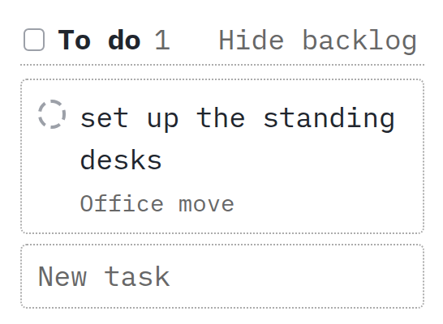

Dragging starts on the card. The drag carries the task page name. While a card hovers over a column, [`tl.placeMarker`](throughline.lua#L1024) puts a marker line before the first card whose middle is below the pointer. Without such a card, the marker goes at the end. Columns that are folded, such as Done, show no marker.

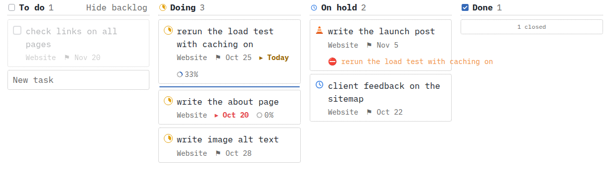

The drop calls [`tl.dropCard`](throughline.lua#L1046). It moves the card to the marker. It notes the cards on either side of the marker. If the column changed, it sets the new state through [`tl.moveCard`](throughline.lua#L954). Then it calls [`tl.reorder`](throughline.lua#L994) with the project. [`tl.reorder`](throughline.lua#L994) moves the card's line in the project page to just before the card below it, else just after the card above it, else to the end of the task list. If the task is not listed at all, it adds a line for it. If no neighbour was found and the task is already listed, the list does not change. The card's `dragend` handler calls [`tl.clearMarker`](throughline.lua#L1018) to remove the marker.

The board also changes the project page's look. [`tl.markProjectPage`](throughline.lua#L2547) runs on each `editor:pageLoaded` event and on every tick of the background clock. It adds the class `tl-project` to the body when the page has the `project` tag, and removes it otherwise. The stylesheet hides SilverBullet's Linked Tasks and Linked Mentions panels under that class.

| Piece | Code |
| --- | --- |
| Board widget | [`tl.board`](throughline.lua#L1160) |
| Column | [`column`](throughline.lua#L1110) |
| Card | [`card`](throughline.lua#L846) |
| Date chips | [`dateChips`](throughline.lua#L762) |
| Project chip | [`projectOf`](throughline.lua#L780) |
| Subtasks | [`subtasksByPage`](throughline.lua#L790) |
| Notes | [`notes`](throughline.lua#L803) |
| Card body | [`cardBody`](throughline.lua#L818) |
| Card chips | [`cardChips`](throughline.lua#L829) |
| Progress ring on a card | [`progressChip`](throughline.lua#L614) |
| Showing a card in a new state | [`placeCard`](throughline.lua#L916) |
| Moving cards to match states changed elsewhere | [`tl.syncWidgets`](throughline.lua#L2369) |
| Redrawing a card's chips | [`tl.refreshCard`](throughline.lua#L934) |
| State change | [`tl.moveCard`](throughline.lua#L954) |
| Column counts | [`tl.recount`](throughline.lua#L900) |
| Board order | [`listOrder`](throughline.lua#L961) |
| Reorder the project list | [`tl.reorder`](throughline.lua#L994) |
| New task button | [`tl.newTaskCard`](throughline.lua#L1089) |
| Hide backlog button | [`tl.toggleBacklog`](throughline.lua#L1076) |
| Backlog and New task (CSS) | [Hide backlog block](Throughline.md?plain=1#L3221) |
| Clear the drop marker | [`tl.clearMarker`](throughline.lua#L1018) |
| Place the drop marker | [`tl.placeMarker`](throughline.lua#L1024) |
| Drop | [`tl.dropCard`](throughline.lua#L1046) |
| Project page panels | [`tl.markProjectPage`](throughline.lua#L2547) |
| Hide the panels (CSS) | [`body.tl-project`](Throughline.md?plain=1#L3659) |
| Board (CSS) | [Board block](Throughline.md?plain=1#L3135) |

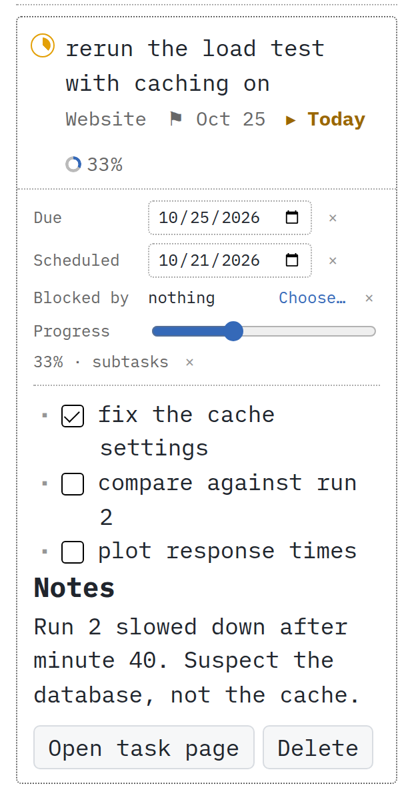

## Project status, updates and health

A project is a page tagged `project`. Its `status` frontmatter sets where it stands. Its `## Updates` section holds dated updates with a health word. The project card shows the newest health. The health turns stale when the newest update is old.

### How it works

[`tl.projectList`](throughline.lua#L1234) returns every page tagged `project`, except pages under `Library/`. [`tl.statusOf`](throughline.lua#L1246) matches the page's `status` against the configured statuses. It compares the status key or the label, ignoring case. A page with no status counts as the first started status. A status that matches nothing gets a section of its own, marked as unknown.

[`tl.updatesOf`](throughline.lua#L1265) reads the text of the page. It finds headings of the form `### 2026-10-19 [health: at-risk]`, and it keeps the text under each one. It returns the updates newest first. Each health word goes through [`normHealth`](throughline.lua#L1225). That function lowercases the word and turns spaces and underscores into hyphens. It also maps `ontrack`, `atrisk` and `offtrack` to their hyphenated forms.

[`tl.healthOf`](throughline.lua#L1286) decides what the health pill shows. A completed or canceled project shows "No update expected". A project with no updates shows "No updates". For a started project, an update older than twice the update cadence shows "Update missing". An update older than the cadence is stale, and the pill still shows its health. Any other update shows its health. The cadence is the `throughline.updateDays` setting, which defaults to 7 days.

Changing a status goes through [`tl.setProjectStatus`](throughline.lua#L1320). It reads the page and passes the text to [`frontmatterSet`](throughline.lua#L1308). That function replaces the `status` line. It adds the line if the frontmatter has none, and it adds a frontmatter block if the page has none. Then the page is written back.

| Piece | Code |
| --- | --- |
| Project list | [`tl.projectList`](throughline.lua#L1234) |
| Status lookup | [`tl.statusOf`](throughline.lua#L1246) |
| Health word | [`normHealth`](throughline.lua#L1225) |
| Updates from the page | [`tl.updatesOf`](throughline.lua#L1265) |
| Health shown on the card | [`tl.healthOf`](throughline.lua#L1286) |
| Frontmatter edit | [`frontmatterSet`](throughline.lua#L1308) |
| Status write | [`tl.setProjectStatus`](throughline.lua#L1320) |

## Time logging

Any list item or task that links to a project can carry a time, such as `[time: 2h30m]`. The overview adds these times for each project. An expanded card shows the time for this week, for the last four weeks, and in total.

### How it works

[`timeEntries`](throughline.lua#L1337) collects every item with a `time` value, from the index. It reads both list items and tasks. Each entry is counted once, by its reference. The day of an entry is its own `date`. Without one, the day is the date in the name of its page, which suits journal pages.

[`minutesOf`](throughline.lua#L261) turns the text into minutes. It reads `2h30m`, `1.5h` and `45m`. A bare number counts as hours when no unit is present.

[`projectData`](throughline.lua#L1358) adds up the minutes for each project it counts. It uses [`weekStart`](throughline.lua#L239) to find the Monday on or before today. Entries from that Monday on count as this week. Entries from the last 28 days count as the four-week figure. Every entry counts toward the total. The overview's stat cells show these three figures through [`fmtMinutes`](throughline.lua#L275). That function shows a dash for zero, then minutes, then hours, then hours and minutes.

| Piece | Code |
| --- | --- |
| Time entries | [`timeEntries`](throughline.lua#L1337) |
| Minutes from text | [`minutesOf`](throughline.lua#L261) |
| Week start | [`weekStart`](throughline.lua#L239) |
| Totals per project | [`projectData`](throughline.lua#L1358) |
| Display | [`fmtMinutes`](throughline.lua#L275) |

## The projects overview

The overview is a widget. Put `${throughline.projects()}` on a page and it shows every project as a card. Cards sit in sections by status. Done and Dropped stay hidden until you press Show completed. Click a card's name to open the project. Click anywhere else on the card to expand it. The expanded card shows the latest update, the status dropdown and the numbers.

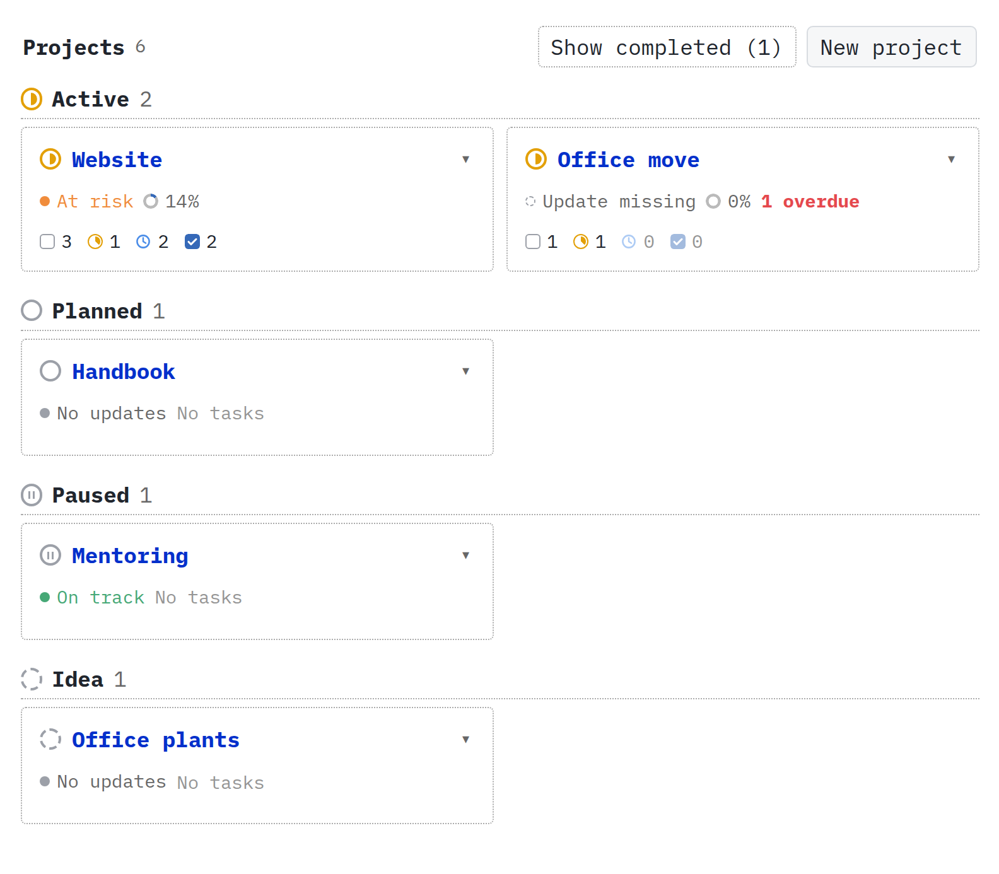

### How it works

[`tl.projects`](throughline.lua#L1608) builds the overview. It takes the board columns from [`boardColumns`](throughline.lua#L1415) and the data for each project from [`projectData`](throughline.lua#L1358). Each project's data comes with its status, updates, health, task counts, progress and time.

The cards sort in a fixed order. A project that the current page links to comes first, in the order of those links. [`mentionOrder`](throughline.lua#L1326) reads that order from the page's links. The other projects follow by next due date, then by title.

The cards then go into sections, one for each configured status. Each status gets a section, even when it has no cards, and the stylesheet hides an empty one. Unknown statuses get a section too. The sections sort by category through [`categoryRank`](throughline.lua#L1558). Sections for completed and canceled statuses carry the class `tl-psection-closed`. The stylesheet hides those sections unless the widget also has the class `tl-show-closed`.

[`projectData`](throughline.lua#L1358) counts the tasks linked to each project. It counts them per board column, and it counts open, done and canceled tasks. An open task that is due before today is overdue. An open task due within 7 days is due soon. The next due task is the earliest open task with a due date. Progress is the done share of all tasks except canceled ones, rounded to a percent. The last activity is the newest change to the project page or to one of its task pages.

[`projectCard`](throughline.lua#L1477) draws each card. The collapsed card shows the category icon, the name, the health pill from [`healthPill`](throughline.lua#L1428), the progress ring from [`progressRing`](throughline.lua#L1437), an overdue chip, and a count per board column. The expanded card shows the latest update and a grid of figures from [`stat`](throughline.lua#L1470). The grid holds the status dropdown from [`statusSelect`](throughline.lua#L1449), and it lists progress, open, overdue, due soon, next due, the three time figures, the update count and last activity. The card ends with Open project and Post update buttons.

Changing the status in the dropdown calls [`tl.changeProjectStatus`](throughline.lua#L1561). It writes the new status with [`tl.setProjectStatus`](throughline.lua#L1320). Then it moves the card element into the grid of its new section and updates its category icon. [`tl.recountSections`](throughline.lua#L1584) recounts the sections. It hides any section with no cards, and it updates the number on the Show completed button.

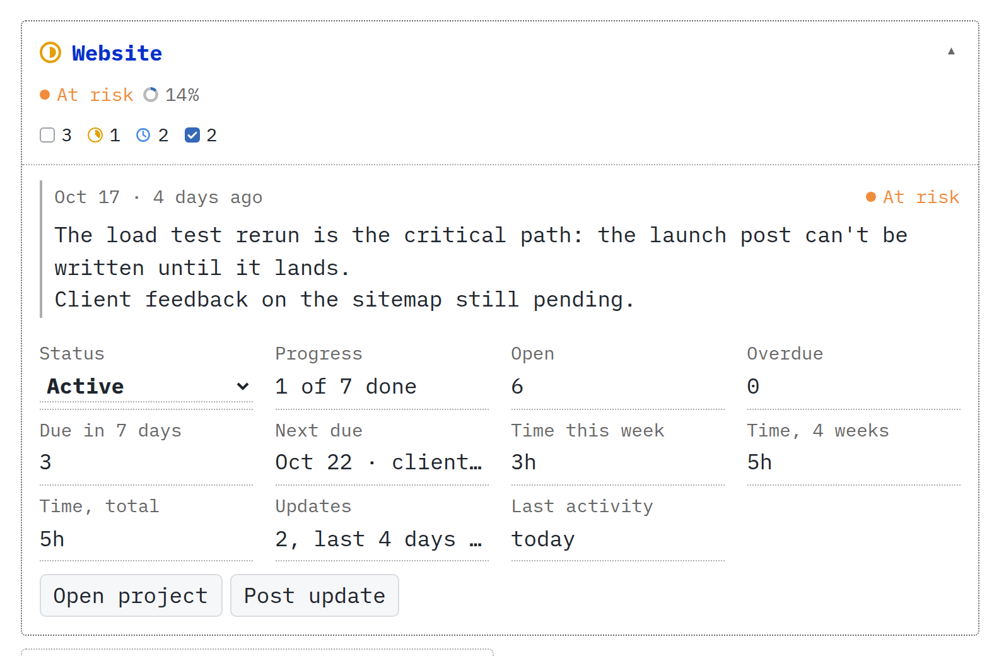

Show completed is a button in the toolbar. [`tl.toggleClosed`](throughline.lua#L1599) switches the class on the widget and saves the choice for the page. The saved value is kept with [`storeSet`](throughline.lua#L176) under a key that holds the page name. [`tl.projects`](throughline.lua#L1608) reads the choice back with [`storeGet`](throughline.lua#L171). Both store functions catch errors, so a failed save only loses the choice.

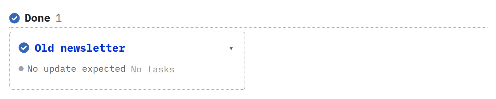

| Piece | Code |
| --- | --- |
| Overview widget | [`tl.projects`](throughline.lua#L1608) |
| Data per project | [`projectData`](throughline.lua#L1358) |
| Board columns | [`boardColumns`](throughline.lua#L1415) |
| Order from links | [`mentionOrder`](throughline.lua#L1326) |
| Section order | [`categoryRank`](throughline.lua#L1558) |
| Project card | [`projectCard`](throughline.lua#L1477) |
| Health pill | [`healthPill`](throughline.lua#L1428) |
| Progress ring | [`progressRing`](throughline.lua#L1437) |
| Status dropdown | [`statusSelect`](throughline.lua#L1449) |
| Figure cell | [`stat`](throughline.lua#L1470) |
| Status change | [`tl.changeProjectStatus`](throughline.lua#L1561) |
| Section counts | [`tl.recountSections`](throughline.lua#L1584) |
| Read a saved choice | [`storeGet`](throughline.lua#L171) |
| Save a choice | [`storeSet`](throughline.lua#L176) |
| Show completed | [`tl.toggleClosed`](throughline.lua#L1599) |
| Project status icons (CSS) | [Project status icons block](Throughline.md?plain=1#L3037) |
| Projects overview (CSS) | [Projects overview block](Throughline.md?plain=1#L3265) |

## Project commands

Three commands in the command palette act on projects: Throughline: New project, Throughline: Post update, and Throughline: Set project status. Post update and Set project status act on the open page when it is a project, and otherwise ask you to pick one. If no project exists, they say how to make one. New project asks for a name.

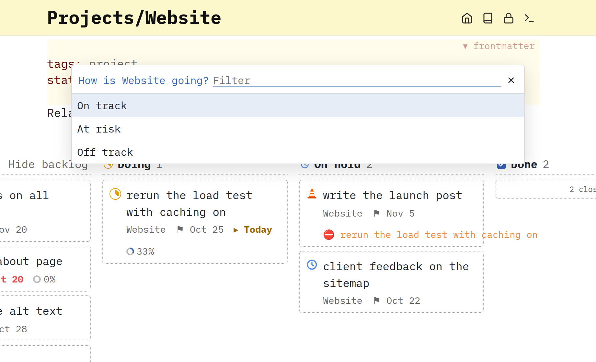

### How it works

[`chooseProject`](throughline.lua#L1691) picks the project for a command. It uses the project it is given, or else the open page. If that page is in the project list, it is used. Otherwise a picker lists the projects.

[`tl.postUpdate`](throughline.lua#L1708) asks for a health: On track, At risk or Off track. It then asks for a line of text. It builds a heading with today's date and the health, followed by the text. It finds the `## Updates` heading and inserts the new update right under it, so the newest update comes first. If the page has no `## Updates` heading, the function adds one at the end of the page. It writes the page and shows a short notice.

[`tl.pickProjectStatus`](throughline.lua#L1742) picks a project, then picks one of the configured statuses. It sets the status through [`tl.setProjectStatus`](throughline.lua#L1320) and shows a notice.

[`tl.newProject`](throughline.lua#L1755) asks for a name. It refuses a blank name and a name that already exists. Otherwise it writes a page in the project folder, named from the input, with the tags `project` and the status `active`. The page gets the board widget and the `## Tasks` and `## Updates` headings. Then it opens the new page.

The three commands are defined at [`command.define`](throughline.lua#L1767). Each one calls the matching `throughline` function.

| Piece | Code |
| --- | --- |
| Project choice | [`chooseProject`](throughline.lua#L1691) |
| Post update | [`tl.postUpdate`](throughline.lua#L1708) |
| Set status | [`tl.pickProjectStatus`](throughline.lua#L1742) |
| New project | [`tl.newProject`](throughline.lua#L1755) |
| Command definitions | [`command.define`](throughline.lua#L1767) |

## The Focus list

The Focus list shows every open task in your space, sorted into sections: Overdue, Doing, Today, On hold, Upcoming, Later and Backlog. Each row has a state icon and a title. A click on the icon opens the state picker. A click on the title opens the task.

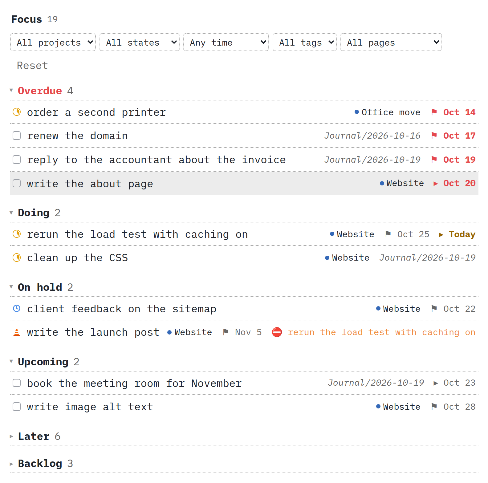

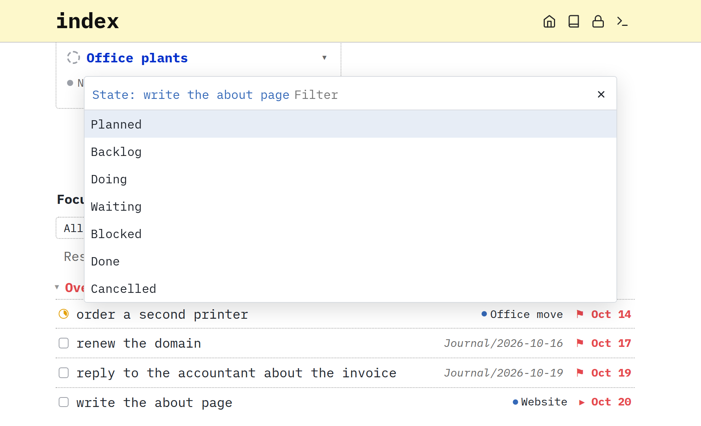

### How it works

[`tl.focus`](throughline.lua#L2205) builds the list when the page renders. It starts from the widget's options, and `project = "this"` means the page the list sits on. It also reads any filter this browser remembers for that page and id. The next section covers the filter.

[`focusTasks`](throughline.lua#L1812) collects the tasks. It reads every task in the index, then drops tasks on `Library/` pages and closed tasks. A task on a task page stays only when it is the page's source task or has a date, so undated subtasks stay off the list. It also returns `sourceOf`, a map from each task page to its source task.

[`focusSection`](throughline.lua#L1796) picks the one section a task belongs to. It checks in this order:

1. Overdue, when the due or scheduled date is before today.
2. Doing, when the task's category is `active`.
3. Today, when the due or scheduled date is today.
4. On hold, when the category is `held`.
5. Upcoming, when the earlier of the two dates falls within the upcoming window.
6. Backlog, when the category is `backlog`.
7. Later, for everything else.

Dates come before the category check at step 6, so a backlog task that is due still appears. The section list and its labels are in [`focusSections`](throughline.lua#L1779). Backlog and Later start folded. [`earliest`](throughline.lua#L1789) returns the earlier of two optional dates. It is how a task gets one date from its due and scheduled fields.

[`focusProjectOf`](throughline.lua#L2052) names the project a row belongs to. It takes the first project the task links to. If there is none, it takes the project page the task sits on. For a subtask on a task page, it takes the project that the page's source task links to.

[`focusRow`](throughline.lua#L2067) builds one row. It adds chips for the project, for the page the task is on, and for the dates. A task page's own task gets no page chip. Each row carries its filter values as `data-` attributes, so filtering never reads the index again. The icon calls [`tl.pickRowState`](throughline.lua#L1898) and stops the click there. The title opens the task page for a source task, and the task's line for any other task.

Inside each section, `tl.focus` sorts rows in three steps. Active tasks come first. Then the earlier date comes first, with undated tasks last. Then the plain task name decides. [`focusSectionNode`](throughline.lua#L2115) wraps a section in a `
` element. The element is open unless the section is folded. An empty section is still rendered, hidden, so that a filter change can show it later.

Changing a state works in place. [`tl.pickRowState`](throughline.lua#L1898) opens the state picker. For a task page's own task, it calls `tl.setTaskPageState`. For any other task, it calls [`tl.setTaskStateAt`](throughline.lua#L1852) with the position stored on the row. On success, the row's icon, category and state change at once. The row stays in its section until the page reloads.

[`tl.setTaskStateAt`](throughline.lua#L1852) checks the position first. The index can give a stale position after an earlier line on the page changes length. The check passes when the line at that position is a task line whose text contains the first 30 characters of the task's name. When the check fails, the function scans the page for the first task line that contains those characters. If it finds none, it shows an error and returns `false`. Otherwise it replaces the text inside the brackets, writes the page through `tl.write`, and clears `tl.stateMap`.

The styling for the list is in the [`Focus list`](Throughline.md?plain=1#L3475) CSS block.

| Piece | Code |
| --- | --- |
| Section keys and labels | [`focusSections`](throughline.lua#L1779) |
| Earlier of two optional dates | [`earliest`](throughline.lua#L1789) |
| Section for one task | [`focusSection`](throughline.lua#L1796) |
| Open tasks and their source map | [`focusTasks`](throughline.lua#L1812) |
| Project a row belongs to | [`focusProjectOf`](throughline.lua#L2052) |
| One row | [`focusRow`](throughline.lua#L2067) |
| One section, folded or open | [`focusSectionNode`](throughline.lua#L2115) |
| The widget: sorting, filter start, output | [`tl.focus`](throughline.lua#L2205) |
| Icon click: state picker and row update | [`tl.pickRowState`](throughline.lua#L1898) |
| Write a state, re-checking the line | [`tl.setTaskStateAt`](throughline.lua#L1852) |
| Focus list styles | [`Focus list`](Throughline.md?plain=1#L3475) |

## Focus filters

The bar above the Focus list has five dropdowns and a Reset button: project, state, when, tag and source. Choosing a value hides the rows and sections that do not match, and the counts change. The browser remembers the choice for each page, so the filter is still there after a reload.

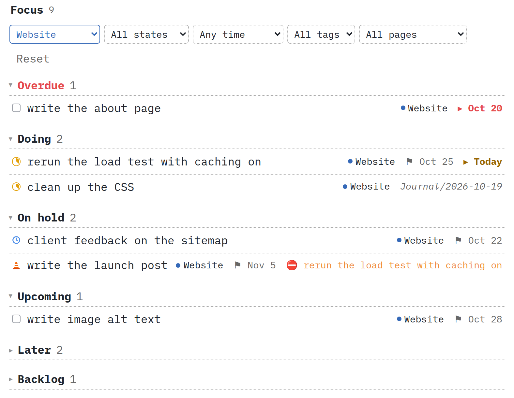

### How it works

[`focusFilterBar`](throughline.lua#L2141) builds the bar from what the list holds. The project dropdown offers the projects in use, a starting project even if no open task has it, and "No project". The state dropdown offers the open states, grouped with the categories. The when dropdown has fixed choices. The tag and folder dropdowns offer only tags and folders in use. [`sortedKeys`](throughline.lua#L2131) gives those sets in alphabetical order. Each dropdown comes from [`filterSelect`](throughline.lua#L2024). Its `onchange` calls `tl.applyFocusFilter` and asks it to remember the choice.

A filter is a table with five keys, listed in [`filterKeys`](throughline.lua#L1919). [`encodeFilter`](throughline.lua#L1921) writes it as `key=value` lines. [`decodeFilter`](throughline.lua#L1927) reads those lines back and drops empty values. The widget stores its starting filter in this form, and the browser stores the remembered one in this form.

The state dropdown uses a prefix. `s:DOING` matches one state, and `c:held` matches a category. [`rowMatches`](throughline.lua#L1936) reads the prefix. The when dropdown matches words. [`whenTokens`](throughline.lua#L1837) gives each row the words it qualifies for: `overdue`, `today`, `week` (within 7 days), `month` (within 30 days), or `undated`. A task due tomorrow gets both `week` and `month`. [`rowMatches`](throughline.lua#L1936) tests every key the filter sets, and a row must pass all of them. For the source key, the folder comes from [`folderOf`](throughline.lua#L1829), which returns the top-level folder of a page, or an empty string at the top level.

[`tl.applyFocusFilter`](throughline.lua#L1974) reads each dropdown into a filter table. It marks each dropdown that has a value. It hides rows that do not match, updates the count in each section and the total in the header, and hides sections with no rows. It shows the "Nothing matches" message when no row is left. When asked to remember, it stores the filter for this list.

[`tl.resetFocusFilter`](throughline.lua#L2010) sets each dropdown back to its starting value, from the widget's `data-defaults`. It clears the stored filter and applies the reset without storing it again.

The remembered filter lives under the key `throughline.focus:` followed by the list's key. The list's key is the page name, then `#`, then the `id` option. Each page and each id keeps its own filter. [`storeGet`](throughline.lua#L171) and [`storeSet`](throughline.lua#L176) wrap the browser's client store in `pcall`. If the store fails, reading gives `nil` and writing does nothing. The filter is then simply not remembered.

The widget is built before it is attached to the page. Its starting filter therefore goes on the page on the next tick. [`tl.applyPendingFilters`](throughline.lua#L2278) finds each list that has no `data-filtered` attribute, sets the attribute, and applies the filter without storing it.

| Piece | Code |
| --- | --- |
| Filter keys | [`filterKeys`](throughline.lua#L1919) |
| Filter table to text | [`encodeFilter`](throughline.lua#L1921) |
| Text to filter table | [`decodeFilter`](throughline.lua#L1927) |
| Date words for a row | [`whenTokens`](throughline.lua#L1837) |
| Top-level folder of a page | [`folderOf`](throughline.lua#L1829) |
| Whether a row passes a filter | [`rowMatches`](throughline.lua#L1936) |
| Apply a filter to the list | [`tl.applyFocusFilter`](throughline.lua#L1974) |
| Reset to the starting filter | [`tl.resetFocusFilter`](throughline.lua#L2010) |
| One dropdown | [`filterSelect`](throughline.lua#L2024) |
| Sorted keys of a set | [`sortedKeys`](throughline.lua#L2131) |
| The whole filter bar | [`focusFilterBar`](throughline.lua#L2141) |
| Starting filters on new lists | [`tl.applyPendingFilters`](throughline.lua#L2278) |
| Read from the browser store | [`storeGet`](throughline.lua#L171) |
| Write to the browser store | [`storeSet`](throughline.lua#L176) |

## Settings and themes

Settings appear under Throughline in Configuration: Open. Each one is a `config.define` call, and the code reads each one through a small getter. The theme setting switches every widget between `native` and `lineish`.

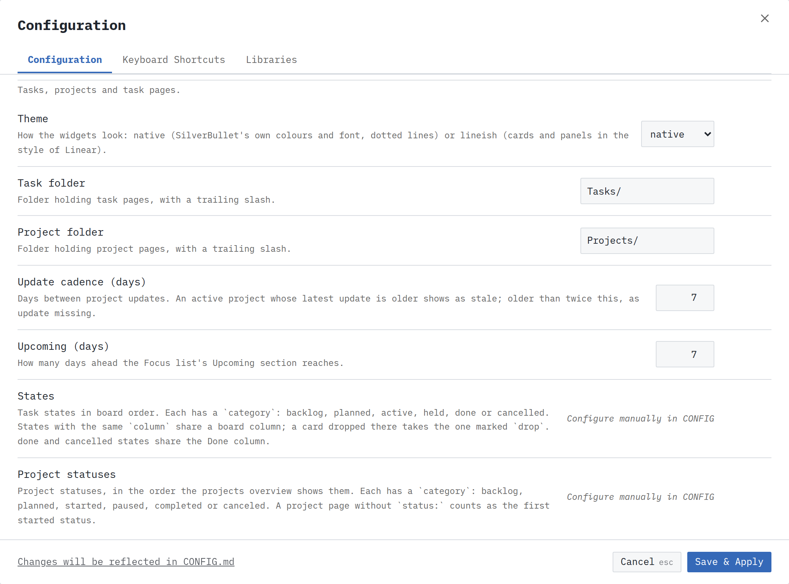

### How it works

[`config.defineCategory`](throughline.lua#L44) creates the Throughline section in the settings menu. Each setting follows it. Task folder, project folder, update cadence and upcoming window are plain values. The states and project statuses are arrays. The theme is a string limited to `native` and `lineish`. Each setting names its menu label and its place in the menu through `ui`.

The state list also feeds the editor. The [loop after the getters](throughline.lua#L123) registers every custom state with `taskState.define`. A state in the `done` or `cancelled` category is marked as done, so SilverBullet draws and completes it the way it does its own states. The built-in `[ ]` and `[x]` states are skipped.

The getters, [`tl.taskFolder`](throughline.lua#L114) and the others on lines 134 to 140, read each setting with `config.get` and a fallback. The rest of the code calls the getters, not the setting keys.

[`tl.applyTheme`](throughline.lua#L2565) copies the theme setting onto the `<html>` element as `data-tl-theme`. It runs once when the file loads and again on every tick. The stylesheet keys every theme off that attribute, and it changes nothing when the value is already right.

The stylesheet's map comment, at the top of the `space-style` block, lists its parts and says the theme rules sit below the lineish rules. [Tokens](Throughline.md?plain=1#L2836) define the colours and font as `--tl-*` variables on `html`. A second block redefines them for SilverBullet's dark mode under `html[data-theme="dark"]`. The lineish theme uses these values as they are.

[Theme: native](Throughline.md?plain=1#L3663) replaces the tokens with SilverBullet's own variables, such as `--editor-font`, `--root-color` and `--ui-accent-color`. So the native theme takes SilverBullet's font and colours. It also removes the shadows and panel backgrounds. It draws rules as dotted lines, makes buttons SilverBullet's own, and leaves board columns open under a heading.

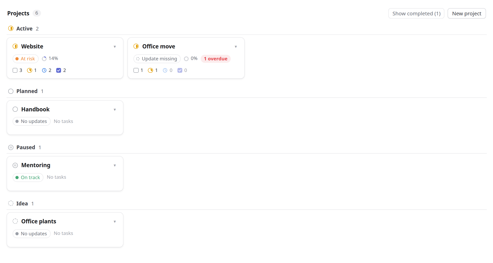
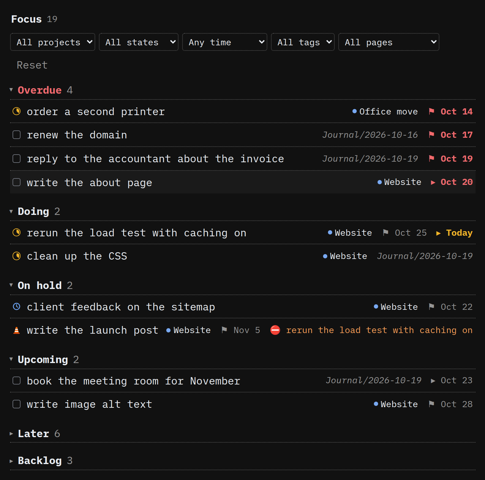

| Piece | Code |
| --- | --- |
| Settings category | [`config.defineCategory`](throughline.lua#L44) |
| Task folder setting | [`config.define`](throughline.lua#L49) |
| Project folder setting | [`config.define`](throughline.lua#L56) |
| States setting | [`config.define`](throughline.lua#L63) |
| Project statuses setting | [`config.define`](throughline.lua#L78) |
| Update cadence setting | [`config.define`](throughline.lua#L92) |
| Upcoming window setting | [`config.define`](throughline.lua#L99) |
| Theme setting | [`config.define`](throughline.lua#L106) |
| Registering custom states with the editor | [loop after the getters](throughline.lua#L123) |
| Getters for each setting | [`tl.taskFolder`](throughline.lua#L114) |
| Copy the theme to `<html>` | [`tl.applyTheme`](throughline.lua#L2565) |
| Stylesheet map | [stylesheet map](Throughline.md?plain=1#L2821) |
| Colour and font tokens | [`Tokens`](Throughline.md?plain=1#L2836) |
| Native theme overrides | [`Theme: native`](Throughline.md?plain=1#L3663) |

## Shared machinery

This part is for someone reading the code. It covers the background tick, the page-load hook and the helpers that the other sections call. The code map at the top of the Lua block lists the sections in order.

### How it works

The code map, at [the top of the file](throughline.lua#L3), gives the sections in the order they appear. It states two facts that most of the code follows. First, widgets are plain HTML built once, when the page renders. When the user acts in a widget, the code updates that HTML in place and writes the page. Nothing re-renders until the page reloads. Second, the index can lag behind the text. Every write therefore re-reads the page and checks the line it is about to change. The code map also says that everything public hangs off the global `throughline` table, which the file calls `tl`. Widget directives and event handlers reach the code through that table.

The [`cron:secondPassed`](throughline.lua#L2556) listener runs once a second. It counts ticks in `tl.tick`. It clears `tl.stateCache`, the cache [`tl.stateTables`](throughline.lua#L305) keeps of the configured states and each state's category: the widgets ask for a state's category several times per task, and reading the configuration each time made the Focus list take most of a second to draw on a space with a few hundred tasks. On every third tick it clears `tl.stateMap`, which is the cache of task states, so the cache refreshes. Then it calls five steps. Each step runs under `pcall`, so one failure does not stop the others:

- `tl.markLinks` draws each projection link's state.
- `tl.syncWidgets` moves board cards and Focus rows whose state changed elsewhere.
- `tl.markProjectPage` sets or clears the `tl-project` class on the body.
- `tl.applyPendingFilters` applies starting filters to new Focus lists.
- `tl.applyTheme` keeps the theme attribute right.

Each step writes to the page only when something differs, so the tick stays cheap.

The [`editor:pageLoaded`](throughline.lua#L2556) listener calls `tl.markProjectPage` when a page opens. On a fresh client, a page's tags may not be indexed yet when it loads. The tick repeats the check for that reason. [`tl.markProjectPage`](throughline.lua#L2547) reads the page's tags. A `project` tag adds the `tl-project` class, which hides SilverBullet's linked-task panels.

The helpers are small. [`splitLines`](throughline.lua#L161) splits text into lines and drops the empty string after a final newline. [`pick`](throughline.lua#L182) wraps SilverBullet's `view.pick` over a list of rows, and [`pickState`](throughline.lua#L398) builds that list from the configured states, with any extra rows at the end. [`today`](throughline.lua#L195) returns the current date as `YYYY-MM-DD`, or `0000-00-00` if the clock fails.

Dates are handled as day numbers. [`dayNumber`](throughline.lua#L210) gives the number of days since 1970-01-01 for an ISO date. [`isoOf`](throughline.lua#L222) turns a day number back into an ISO date. [`addDays`](throughline.lua#L236) adds days to a date. The code comment says this uses plain arithmetic, so it does not depend on what `os.time` supports. [`daysAgo`](throughline.lua#L244) gives the difference in days, and [`ago`](throughline.lua#L250) turns it into words: "today", "yesterday", "N days ago", weeks, or months. It returns "never" for a missing date.

[`tl.plainText`](throughline.lua#L426) reduces task text to plain words. It removes attribute tokens such as `[due: ...]`. It keeps the alias of a `[[page|alias]]` link and drops other links. It then collapses whitespace. The result is used for titles, aliases, slugs and name matching.

| Piece | Code |
| --- | --- |
| Code map and the two facts it states | [`How this file is laid out`](throughline.lua#L3) |
| Background tick, once a second | [`cron:secondPassed`](throughline.lua#L2556) |
| Page-load hook | [`editor:pageLoaded`](throughline.lua#L2556) |
| Project page class | [`tl.markProjectPage`](throughline.lua#L2547) |
| Split text into lines | [`splitLines`](throughline.lua#L161) |
| Picker over rows | [`pick`](throughline.lua#L182) |
| Picker over states | [`pickState`](throughline.lua#L398) |
| Today's date | [`today`](throughline.lua#L195) |
| ISO date to day number | [`dayNumber`](throughline.lua#L210) |
| Day number to ISO date | [`isoOf`](throughline.lua#L222) |
| Add days to a date | [`addDays`](throughline.lua#L236) |
| Days between two dates | [`daysAgo`](throughline.lua#L244) |
| Days as words | [`ago`](throughline.lua#L250) |
| Task text as plain words | [`tl.plainText`](throughline.lua#L426) |
