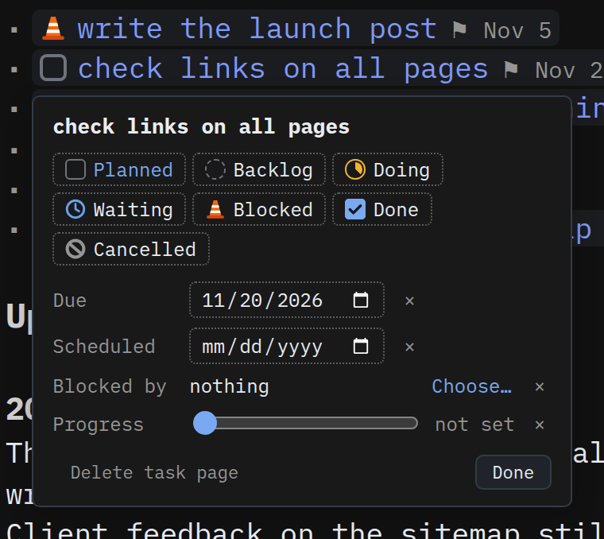
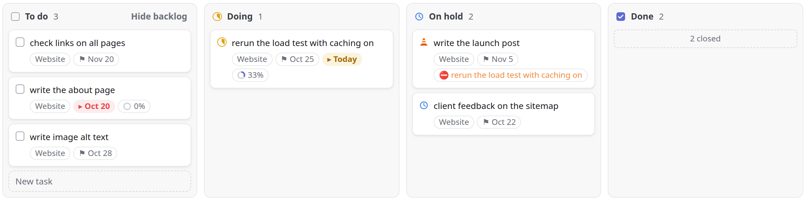

# Throughline

Project tracking for [SilverBullet](https://silverbullet.md), kept in plain
markdown. Tasks, projects and the notes you write while working stay in your
pages, and Throughline gives you three views over them: a board per project, an
overview of all projects, and a list of what to do next.


Throughline is alpha software. Everything described here works, but names,
settings and page formats may still change between 0.0.x versions. The
[changelog](CHANGELOG.md) says what changed.

It needs SilverBullet 2.12 or later. It is one library page of Space Lua and
Space Style, with no plug and nothing to build.

## Install

Run `Library: Install` and give it this address:

```
ghr:tanekere/throughline/Throughline.md
```

`ghr:` is SilverBullet's address for GitHub releases. It installs
`Throughline.md` from the latest full release and skips pre-releases.
SilverBullet never updates a library by itself; Configuration → Libraries →
Update all fetches the newest release when you choose to.

Then put the two overview widgets on a page, your index for example:

```markdown
${throughline.projects()}

${throughline.focus()}
```

## Getting started

1. Run `Throughline: New project` and call it "Website". You get
   `Projects/Website`, with a board, a `## Tasks` heading and a `## Updates`
   heading.
2. Write tasks anywhere, as ordinary markdown, and link the project:
   `- [ ] write the about page [[Projects/Website]] [due: 2026-11-01]`.
3. When a task needs room for notes, put the cursor on it and run
   `Throughline: Make task page`, or type `/task`. The task moves to a page of
   its own and a link to it takes its place.
4. Open the project. Its tasks are on the board.
5. Once a week or so, run `Throughline: Post update` to say how the project is
   going. The overview shows the latest health on the project's card.

## How it works

**A task is a markdown task.** `- [DOING] rerun the load test [due: 2026-10-25]`
works anywhere in your space. SilverBullet indexes it; Throughline reads the
index.

**A task page is a task with room.** When a task needs notes, data or
subtasks, it gets a page in `Tasks/`. The first task on that page is the task;
the rest of the page is its notebook. A task page belongs to the project its
task links to.

**A projection is a link to a task page.** On every other page the task
appears as a plain link, `- [[Tasks/rerun-load-test|rerun the load test]]`, drawn
with the task's current state and, when it has one, its due date. Click the
text to open the page. Click the icon or the date to edit the task without
leaving the list:



Pick a state, set the due and scheduled dates with the calendar, choose the
task it is blocked by, or drag Progress. Every change is written to the task
page at once, and the board on the same page follows. A task's progress is its share of done subtasks until
you set it yourself; × goes back to that. Blocked by is written as
`[blockedBy: [[Tasks/…]]]` on the task's line, and the board and the Focus list
show "⛔ blocked by …", struck through once that task is finished.

**A project is a page tagged `#project`.** Its `status:` frontmatter says
where it stands: `active`, `planned`, `paused`, `idea`, `done` or `dropped`. A
page without `status:` counts as active.

## States

| Markdown | Icon | Category | Board column |
| --- | --- | --- | --- |
| `[ ]` | checkbox | planned | To do |
| `[BACKLOG]` | dashed circle | backlog | To do |
| `[DOING]` | ring filling clockwise | active | Doing |
| `[WAITING]` | clock | held | On hold |
| `[BLOCKED]` | traffic cone | held | On hold |
| `[x]` | ticked box | done | Done |
| `[CANCELLED]` | no-entry sign | cancelled | Done |

Click a state in the editor to cycle through them, as with any SilverBullet
task. Throughline acts on the category, never on the state's name. A state you
add, say `[REVIEW]` in the active category, shows up under Doing in the Focus
list with no other setup. See [Settings](#settings).

## The board

```markdown
${throughline.board()}
```

Put this on a project page. There is one column per open state, with Planned
and Backlog sharing To do and Waiting and Blocked sharing On hold, and a folded
Done column. Each card is one of the project's task pages. Expand a card to set
its dates and progress, see its subtasks and notes, and tick subtasks right
there.


New task, at the end of the To do column, asks for the task and creates its
task page, linked to the project. Hide backlog, in the To do column's header,
hides backlog tasks on every board; your browser remembers the choice.

Drag a card to another column to change its state, or between cards to reorder
it. A state changed anywhere else on the page, in the task list for example,
moves the card at once.

The board's order lives in the project page. Cards follow the order in which
the page lists its projections, usually under `## Tasks`, and dragging a card
rewrites that list. Task pages the list leaves out follow, earliest due first.

## Projects overview

```markdown
${throughline.projects()}
```

Every project as a card, grouped by status: Active, Planned, Paused, Idea. Done
and Dropped stay hidden until you press Show completed. A card shows the
project's health, the share of its tasks that are done, and how many tasks sit
in each board column.

Click a card anywhere except its name to open its numbers: the latest update,
the status (which you can change there), overdue and upcoming tasks, the next
due date, time logged and last activity. Click the name to open the project.


If the page holding the overview links to projects, the cards follow that
order. Otherwise they sort by next due date.

### Updates and health

A project's health comes from its newest dated update:

```markdown
## Updates

### 2026-10-19 [health: at-risk]
Printer delivery slipped a week; the office setup waits on it.
```

Health is `on-track`, `at-risk` or `off-track`. `Throughline: Post update`
writes the heading for you. An active project whose newest update is more than
7 days old shows its health as stale, with a hollow dot; after 14 days the card
says Update missing.

### Time

Any list item or task that links to a project can carry a duration:

```markdown
- about page [[Projects/Website]] [time: 2h30m]
```

`2h30m`, `1.5h`, `45m`, and a bare number of hours all work. A journal page is
the natural place for these. The day counted is the item's `[date: …]`, else
the date in its page's name. The expanded card adds them up for this week, the
last four weeks, and in total.

## Focus

```markdown
${throughline.focus()}
```

Every open task in your space, in the order you would want to work through it:

| Section | What goes there |
| --- | --- |
| Overdue | the due or scheduled date has passed |
| Doing | active tasks |
| Today | due or scheduled today |
| On hold | held tasks |
| Upcoming | dated within the next 7 days |
| Later | planned tasks with no date or a later one, folded |
| Backlog | backlog tasks with no near date, folded |


A task goes in the first section that fits. Inside a section, active tasks come
first, then the earliest date. Click a row's icon to change its state and its
text to open it. The list includes each task page's task, every task on other
pages, and dated subtasks on task pages. Pages under `Library/` are left out.

The bar above the list filters by project, state or category, date, tag, and
where the task lives (task pages, other pages, or a top-level folder). Your
browser remembers the filter for each page. Reset goes back to the starting
filter, which you can give the widget:

```markdown
${throughline.focus { project = "this" }}
${throughline.focus { category = "held" }}
${throughline.focus { when = "week", source = "Journal" }}
```

| Key | Values |
| --- | --- |
| `project` | a page name, `"this"` for the page the list is on, or `"none"` |
| `state` | a state, such as `"DOING"` |
| `category` | `"backlog"`, `"planned"`, `"active"` or `"held"` |
| `when` | `"overdue"`, `"today"`, `"week"`, `"month"` or `"undated"` |
| `tag` | a tag, without the `#` |
| `source` | a top-level folder, `"/"` for the top level, `"task-pages"` or `"other-pages"` |
| `id` | any text; two lists on one page need different ids to keep separate filters |

## Commands

| Command | What it does |
| --- | --- |
| Throughline: Make task page, or `/task` | Moves the task under the cursor and its subtasks to a new task page, leaves a projection in their place, and adds the projection to the project's list |
| Throughline: Promote subtask | The same, for a subtask on a task page. The new page records `[partOf: [[Tasks/<parent>]]]` |
| Throughline: Delete task page | Deletes the task page and every projection of it, after showing you where they are |
| Throughline: New project | Creates `Projects/<name>` with a board and the `## Tasks` and `## Updates` headings |
| Throughline: Post update | Asks how the project is going and for a line of text, then adds a dated update |
| Throughline: Set project status | Sets the open project's `status:`, or one you pick |

Delete task page is also on every board card and in a projection's editing
panel.

## Settings

Run Configuration: Open and find the Throughline section.

| Setting | Default | What it does |
| --- | --- | --- |
| Theme | native | native follows your SilverBullet theme: its font and colours, no backgrounds, dotted lines. lineish is a card-and-panel look after Linear |
| Task folder | `Tasks/` | where task pages go |
| Project folder | `Projects/` | where New project puts projects |
| Update cadence (days) | 7 | when an active project's health goes stale; twice this and it says Update missing |
| Upcoming (days) | 7 | how far ahead Focus's Upcoming section looks |

<p>


</p>

The state and project status lists cannot be edited in the menu, which only
handles single values. To change them, copy the defaults into a `space-lua`
block on your `CONFIG` page and edit them there:

```lua
config.set("throughline.states", {
  { state = " ",         label = "Planned",   category = "planned",   column = "To do", drop = true },
  { state = "BACKLOG",   label = "Backlog",   category = "backlog",   column = "To do" },
  { state = "DOING",     label = "Doing",     category = "active" },
  { state = "WAITING",   label = "Waiting",   category = "held",      column = "On hold" },
  { state = "BLOCKED",   label = "Blocked",   category = "held",      column = "On hold", drop = true },
  { state = "x",         label = "Done",      category = "done" },
  { state = "CANCELLED", label = "Cancelled", category = "cancelled" },
})
config.set("throughline.projectStatuses", {
  { status = "active",  label = "Active",  category = "started" },
  { status = "planned", label = "Planned", category = "planned" },
  { status = "paused",  label = "Paused",  category = "paused" },
  { status = "idea",    label = "Idea",    category = "backlog" },
  { status = "done",    label = "Done",    category = "completed" },
  { status = "dropped", label = "Dropped", category = "canceled" },
})
```

States are listed in board order. Task categories are `backlog`, `planned`,
`active`, `held`, `done` and `cancelled`. Project categories are `backlog`,
`planned`, `started`, `paused`, `completed` and `canceled`, the same ones
Linear uses.

States with the same `column` share a board column. A card dragged into that
column takes the state marked `drop = true`, or the column's first. Done and
cancelled states always share the Done column. Only the default states have
icons; any other state shows as its name.

## Known limits

- Widgets are drawn when the page is. A state change made on another device,
  or by editing a task page by hand, reaches an open board within about three
  seconds; other changes made elsewhere show the next time you open the page.
- Projection icons are drawn in the editor only, not in the page picker or in
  completion.
- When you delete a task page, the server only learns of it at the next sync.
- Drag and drop needs a mouse. On touch screens, change a task's state from the
  task list.

## Development

`Throughline.md` is the whole library. Its code is also in `throughline.lua`,
an exact copy of the `space-lua` block for reading with syntax highlighting;
`python3 scripts/extract-lua.py` regenerates it after a change, and a release
fails if the two differ. Read the code from the top: a comment there maps the
sections and explains the two ideas most of the code follows.
[EXPLAINER.md](EXPLAINER.md) goes through every feature and links each part of
it to the lines that implement it.

`test-space/` is a small space with projects, task pages and journal entries
that exercise every feature. Copy it, together with `Throughline.md` under
`Library/`, into an empty SilverBullet space to try changes.
`test-overrides/` adds a custom state and folder settings; `test-lineish/`
switches the theme. `test-perf/Perf.md` times the main pieces on whatever
space it is copied into.

To release a version:

1. Add a `## X.Y.Z (date)` section to [CHANGELOG.md](CHANGELOG.md).
2. Tag the commit `vX.Y.Z` and push the tag.

The workflow in `.github/workflows/release.yml` then creates the GitHub release,
with `Throughline.md` attached and the changelog section as its notes. A tag
with a suffix, such as `v0.0.4-rc1`, becomes a pre-release, which `ghr:`
installs skip.

## License

Throughline is licensed under either the [Apache License 2.0](LICENSE-APACHE)
or the [MIT license](LICENSE-MIT), at your option.
